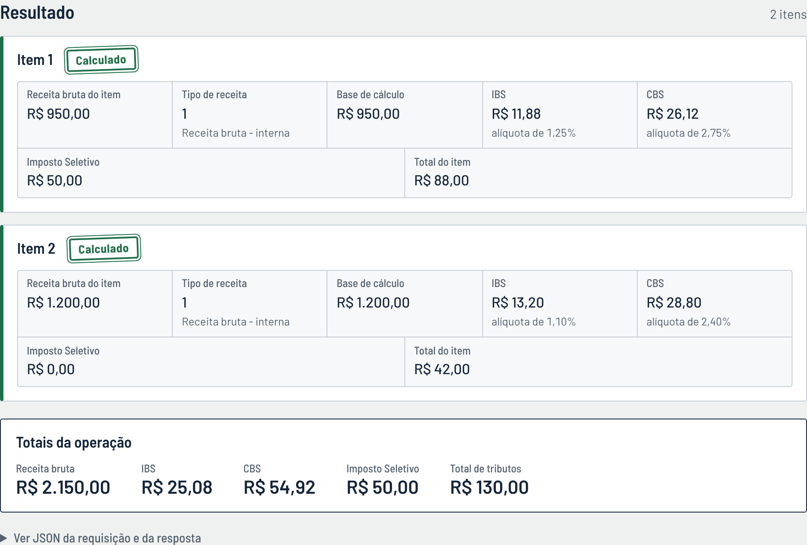
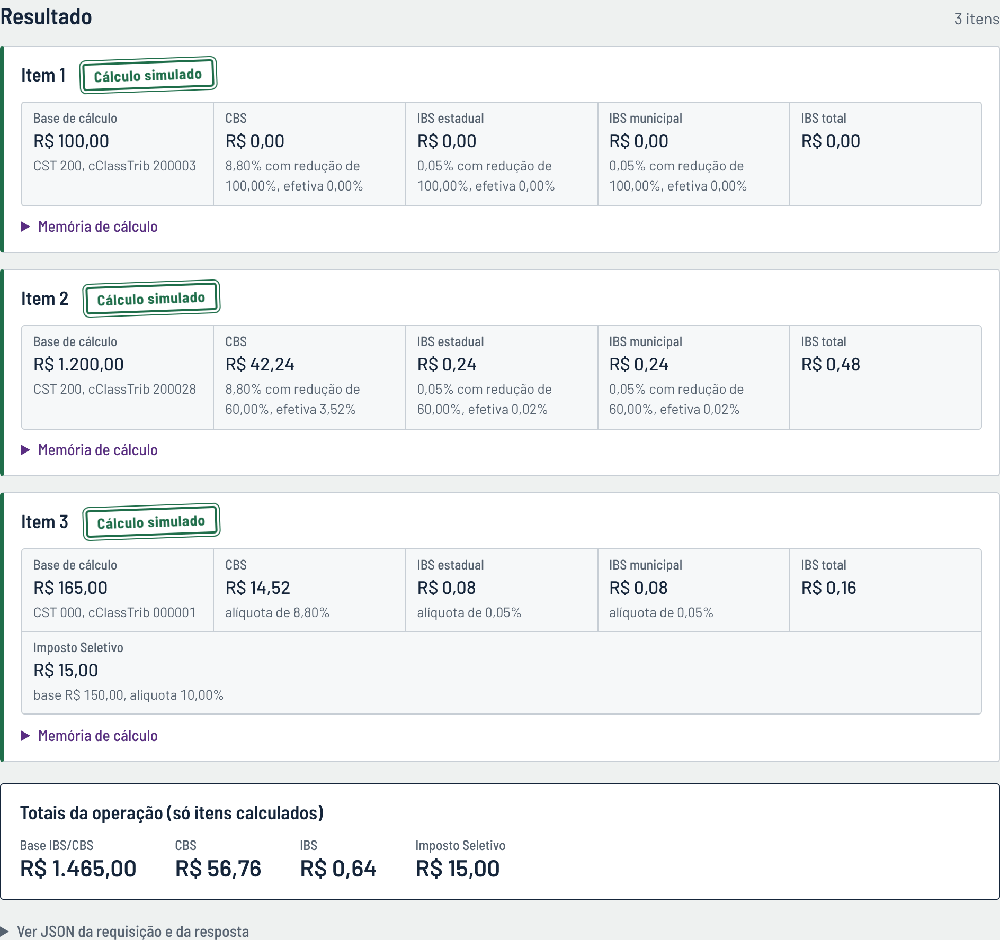
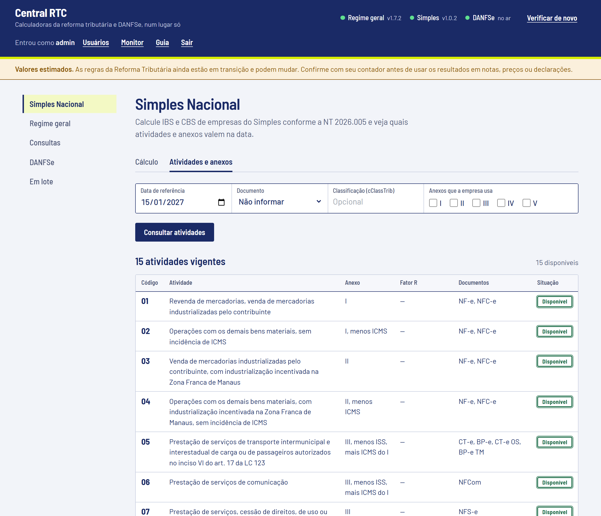
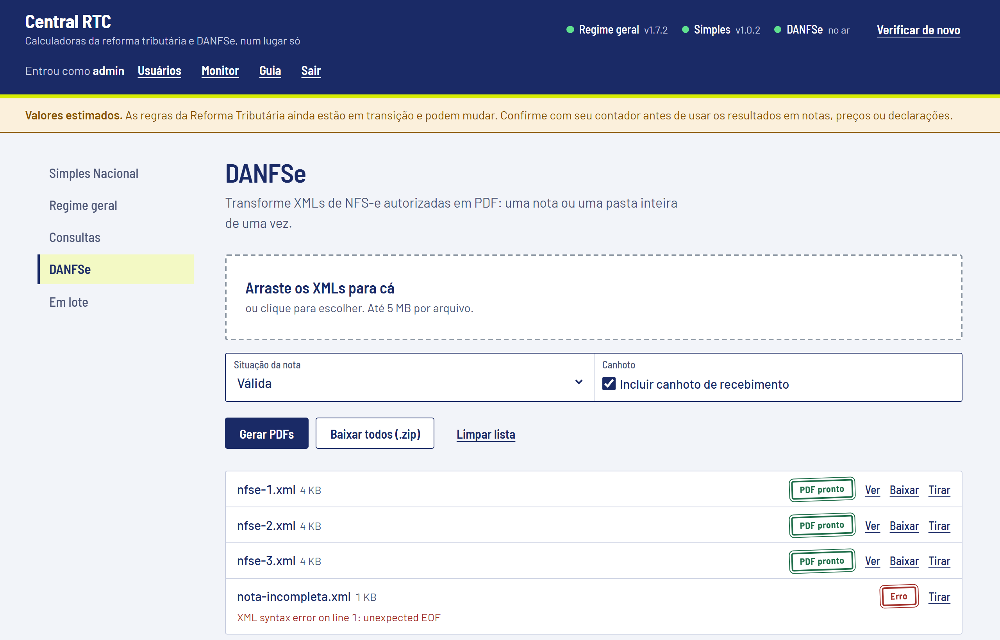
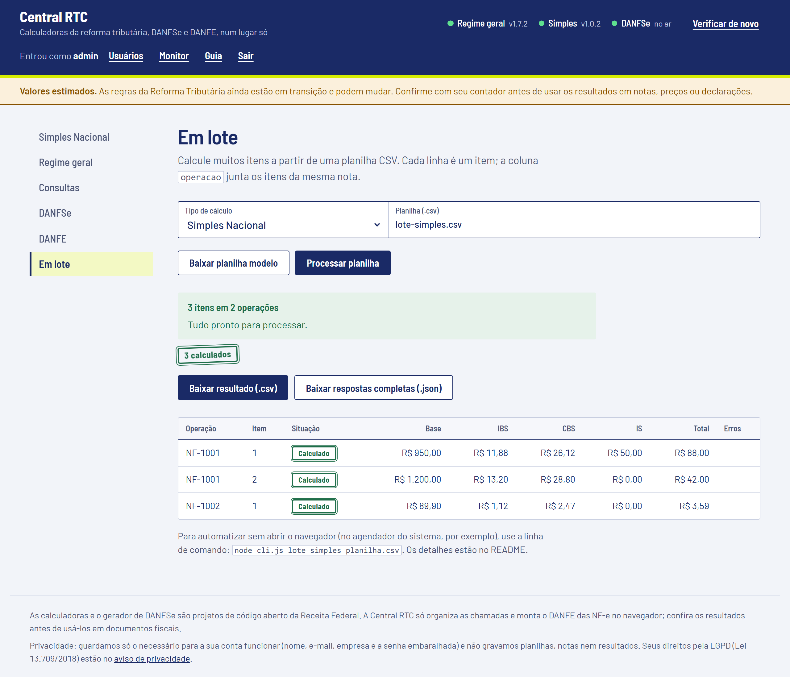

<div align="center">

# Central RTC

**As calculadoras da Reforma Tributária do Consumo e o gerador de DANFSe da Receita Federal, num painel só.**

[](https://github.com/PedrosHttps/central-rtc/actions/workflows/testes.yml)
[](LICENSE)
[](painel/package.json)
[](docker-compose.yml)

**Disponível online: [central-rtc.taild4c7a5.ts.net](https://central-rtc.taild4c7a5.ts.net)** (peça uma conta na tela de entrada)

[Página do projeto](https://pedroshttps.github.io/central-rtc/) ·
[Guia de uso](https://pedroshttps.github.io/central-rtc/guia.html) ·
[Instalar](#como-rodar-com-docker) ·
[Linha de comando](#linha-de-comando) ·
[Planilhas](#planilhas-do-lote)



</div>

Um painel web e uma linha de comando que juntam os três serviços de código aberto da Receita Federal para a reforma tributária:

| Serviço | Repositório oficial | O que faz |
|---|---|---|
| Regime geral | [calculadora-rtc-regime-regular](https://github.com/ReceitaFederal/calculadora-rtc-regime-regular) | CBS, IBS e Imposto Seletivo por item, tabelas oficiais, geração e validação do XML |
| Simples Nacional | [calculadora-rtc-simples-nacional](https://github.com/ReceitaFederal/calculadora-rtc-simples-nacional) | IBS e CBS do Simples (NT 2026.005) e catálogo de atividades × anexos |
| DANFSe | [calculadora-rtc-gerador-danfse](https://github.com/ReceitaFederal/calculadora-rtc-gerador-danfse) | PDF do DANFSe a partir do XML da NFS-e |

A Central RTC não recalcula nada por conta própria: ela monta as requisições, chama os serviços oficiais e organiza as respostas.

> [!NOTE]
> Projeto independente, sem vínculo com a Receita Federal. Confira os resultados antes de usá-los em documentos fiscais.

## O que dá para fazer

- **Simples Nacional**: calcular IBS e CBS item a item, ver o estado de cada item (calculado, não calculado, inconsistência) com os códigos `VSN-` explicados, e consultar quais atividades (`cAtivSN`) estão disponíveis para os anexos e o documento da empresa.
- **Regime geral**: calcular CBS, IBS e IS com memória de cálculo, e gerar e validar o XML do grupo de tributação (NF-e, NFC-e, CT-e, BP-e, NF3e).
- **Consultas**: cClassTrib, NCM, NBS, alíquotas de referência e descrição de códigos de erro.
- **DANFSe**: arrastar vários XMLs de NFS-e e baixar todos os PDFs num `.zip`.
- **Em lote**: processar uma planilha CSV com centenas de itens e baixar o resultado em CSV (abre direto no Excel) e as respostas completas em JSON.

Tudo isso também roda pela linha de comando, para agendar ou encaixar em outros scripts.

## Telas

<table>
  <tr>
    <td width="50%"><br><sub><b>Regime geral:</b> redução, alíquota efetiva e memória de cálculo por item</sub></td>
    <td width="50%"><br><sub><b>Atividades do Simples:</b> o que está disponível para os anexos e o documento</sub></td>
  </tr>
  <tr>
    <td width="50%"><br><sub><b>DANFSe:</b> vários XMLs de uma vez, com o motivo de cada erro</sub></td>
    <td width="50%"><br><sub><b>Em lote:</b> planilha entra, planilha sai</sub></td>
  </tr>
</table>

<sub>Capturas feitas com o simulador de desenvolvimento do projeto; os valores são fictícios.</sub>

## Como rodar (com Docker)

Precisa do Docker Desktop (Windows/macOS) ou Docker Engine com o plugin Compose (Linux).

```bash
docker compose up -d --build
```

Depois abra **http://localhost:3000**. As bolinhas no topo do painel ficam verdes quando cada serviço responde.

A primeira subida demora: o Docker baixa o código dos três repositórios, as dependências do Maven e do Go, e gera o banco SQLite com as migrações oficiais. As próximas são rápidas.

| Endereço | O que é |
|---|---|
| http://localhost:3000 | Painel da Central RTC |
| http://localhost:8080/api/swagger-ui.html | Swagger do regime geral |
| http://localhost:8082/api/swagger-ui.html | Swagger do Simples Nacional |
| http://localhost:8081/api/swagger-ui/index.html | Swagger do DANFSe |

As portas ficam presas ao `127.0.0.1`, então só o seu computador acessa.

**Atualizar para a versão mais nova da Receita:** `docker compose build --no-cache && docker compose up -d`.

## Como rodar (sem Docker)

1. Suba os três serviços. Você vai precisar de Java 25 (regime geral e Simples), Go 1.27 (DANFSe) e Git; o Maven não, os repositórios trazem o `mvnw`.
   - **No Windows**, o script faz tudo: clona em `Documents\rfb-servicos`, gera o banco, compila (só na primeira vez) e abre cada serviço numa janela.
     ```powershell
     powershell -ExecutionPolicy Bypass -File servicos-windows.ps1
     ```
   - **Em outro sistema**, siga o README de cada repositório. O Simples Nacional usa o mesmo banco do regime geral: copie `calculadora/db/calculadora-pro.db` gerado no regime geral para a mesma pasta dentro do projeto do Simples. O DANFSe também usa a porta 8080 por padrão: rode com `SERVER_PORT=8081`.
2. Rode o painel (Node 22 ou mais novo, sem `npm install`):

```bash
cd painel
node server.js
```

Se os serviços estiverem em outros endereços, use as variáveis `RG_URL`, `SN_URL` e `DANFSE_URL` (veja abaixo).

## Linha de comando

Fica em `painel/cli.js` e usa o mesmo motor do painel.

```bash
cd painel
node cli.js status                                      # confere se os três serviços respondem
node cli.js modelo simples -o minha-planilha.csv         # planilha de exemplo para preencher
node cli.js lote simples minha-planilha.csv              # gera minha-planilha-resultado.csv
node cli.js lote regime-geral notas.csv --json respostas.json
node cli.js danfse ./xmls -o ./pdfs                      # uma pasta inteira de NFS-e para PDF
node cli.js danfse nota.xml --stc 2 --sem-canhoto        # nota cancelada, sem canhoto
```

Códigos de saída: `0` deu tudo certo, `1` erro de uso ou serviço fora do ar, `2` terminou mas algum item ou nota falhou. Isso facilita agendar:

```bash
# Linux/macOS (crontab): todo dia às 6h, converte os XMLs que chegaram
0 6 * * * cd /caminho/central-rtc/painel && node cli.js danfse ~/notas/entrada -o ~/notas/pdf
```

No Windows, use o Agendador de Tarefas com o programa `node` e os argumentos `cli.js danfse C:\notas\entrada -o C:\notas\pdf`, iniciando na pasta `painel`.

| Variável | Padrão | Para quê |
|---|---|---|
| `RG_URL` | `http://localhost:8080/api` | Regime geral |
| `SN_URL` | `http://localhost:8082/api` | Simples Nacional |
| `DANFSE_URL` | `http://localhost:8081` | Gerador de DANFSe |
| `PORTA` | `3000` | Porta do painel |
| `HOST` | `127.0.0.1` | Interface do painel (`0.0.0.0` só dentro do Docker) |
| `PAINEL_USUARIO` e `PAINEL_SENHA` | vazias (sem login) | Ligam a tela de login. Essa é a conta do administrador, que cadastra as outras pessoas. Obrigatórias antes de deixar o painel acessível por outros aparelhos. A senha precisa ter 12 caracteres ou mais. No Docker, coloque as duas no arquivo `.env` da raiz, que fica fora do Git. |
| `PAINEL_EMAIL_ACESSO` | vazia | E-mail de contato mostrado na tela de login. Vazia, o contato não aparece. |
| `PAINEL_TOKEN_REVISAO` | vazia | Chave (32 caracteres ou mais) da revisão automática de pedidos. Com `Authorization: Bearer <chave>` só dá para `GET /api/pedidos` e `POST /api/usuarios/<e-mail>/aprovar` ou `recusar`. |
| `PAINEL_DADOS` | `painel/dados` | Pasta do `usuarios.json`, com as contas cadastradas (só o hash das senhas). No Docker fica no volume `contas`. |
| `GOOGLE_CLIENT_ID`, `GOOGLE_CLIENT_SECRET` e `PAINEL_URL` | vazias | Ligam o **Entrar com Google**. `PAINEL_URL` é o endereço `https` público do painel. Veja abaixo como criar o app no Google. |

### Contas de usuário

Com o login ligado, há dois caminhos para alguém ganhar acesso:

- **A pessoa pede sozinha:** em **Criar conta**, na tela de login, ela informa nome, e-mail (que vira o usuário), empresa, motivo e a senha que escolher. A conta nasce **em análise** e só funciona depois de aprovada. O mesmo endereço de internet só consegue fazer 3 pedidos por hora, e o painel aceita no máximo 100 pedidos aguardando análise.
- **O administrador cadastra:** em **Usuários**, ele cria a conta com uma senha provisória. No primeiro acesso, o painel obriga a pessoa a trocar essa senha.

Os pedidos são aprovados ou recusados pelo administrador, também em **Usuários**, ou por uma revisão automática que usa a chave `PAINEL_TOKEN_REVISAO`. Por exemplo, uma tarefa agendada do Claude Code que lê os pedidos e decide seguindo regras escritas. A tela mostra quem decidiu e por quê. Em **Usuários**, o administrador também gera uma senha provisória nova para quem esqueceu e remove o acesso de quem saiu. Quem é removido sai na hora.

Depois de 10 senhas erradas em 15 minutos, o endereço de internet fica sem conseguir entrar por 15 minutos. As sessões duram 12 horas e só existem na memória: reiniciar o painel pede login de novo a todos.

### Entrar com Google

Com o login com Google ligado, quem entra pelo botão do Google sem ter conta cai em **Criar conta**. O nome e o e-mail já vêm preenchidos, e não é preciso escolher senha. O pedido passa pela mesma análise e aparece marcado como "e-mail confirmado pelo Google". Quem já tem conta com o mesmo e-mail entra direto.

Para ligar:
1. No [Google Cloud Console](https://console.cloud.google.com/), crie um projeto. Em **APIs e serviços → Tela de permissão OAuth**, escolha o tipo **Externo**, preencha nome e e-mail e publique o app (**Em produção**). Os escopos `openid`, `email` e `profile` não precisam de verificação do Google.
2. Em **Credenciais → Criar credenciais → ID do cliente OAuth**, escolha **Aplicativo da Web**. Em **URIs de redirecionamento autorizados**, coloque `<PAINEL_URL>/api/google/retorno`.
3. Copie o ID e a chave secreta para `GOOGLE_CLIENT_ID` e `GOOGLE_CLIENT_SECRET` no `.env`, defina `PAINEL_URL` e rode `docker compose up -d`.

O painel usa o fluxo de código com PKCE e `state` amarrado a um cookie. O `id_token` vem direto do Google, e o painel confere emissor, destinatário, validade e se o e-mail foi confirmado. A chave secreta fica só no servidor.

## Planilhas do lote

- Separador `;` ou `,` (detectado sozinho). Decimais com vírgula ou ponto: `1.234,56` e `1234.56` funcionam.
- Datas em `15/03/2027` ou `2027-03-15`. No regime geral, `dhFatoGerador` aceita `10/03/2027 10:00`; sem fuso, usa o do computador.
- Cada linha é um item. Linhas com o mesmo valor em `operacao` viram uma única requisição (uma nota). Os dados da operação (data, documento, CRT…) valem os da primeira linha do grupo.
- O resultado sai com `;` e vírgula decimal, pronto para o Excel em português, com a coluna `linhaPlanilha` apontando de onde veio cada item.

**Simples Nacional:** `operacao, data, tpDoc, CRT, tpRegimeIBSCBS, tpEnteGov, item, cAtivSN, cClassTrib, baseCalculo, valorImpostoSeletivo, pIBSSN, pCBSSN`

**Regime geral:** `operacao, dhFatoGerador, municipio, uf, tpDoc, tpEnteGov, item, ncm, nbs, cst, cClassTrib, baseCalculo, quantidade, unidade, aliqCBS, aliqIBSUF, aliqIBSMun` e, para Imposto Seletivo, `isCst, isClassTrib, isBaseCalculo, isQuantidade, isUnidade, isImpostoInformado, isAdValorem, isAdRem`.

Use `node cli.js modelo <tipo>` ou o botão **Baixar planilha modelo** para começar de um arquivo pronto.

## Regras que vale lembrar

- **Regime geral, a partir de 2027:** as alíquotas nominais são obrigatórias em cada item, e o resultado sai como *cálculo simulado*. Antes de 2027 elas são proibidas, e a calculadora usa as alíquotas de referência de 2026. O painel esconde ou mostra os campos conforme a data.
- **Simples Nacional:** item sem `cAtivSN` (ou com atividade fora de vigência ou não admitida no documento) não é calculado, sem erro. As alíquotas efetivas (`pIBSSN`, `pCBSSN`) vêm da apuração da empresa.
- **DANFSe:** é o documento auxiliar de uma NFS-e já autorizada. Use os XMLs que o emissor devolveu.

## Desenvolvimento

```bash
cd painel
npm run teste        # testes das bibliotecas (não precisam dos serviços)
npm run simulador    # imita os três serviços com dados FICTÍCIOS, para mexer na interface
npm start            # painel
```

O simulador (`dev/mock-servicos.js`) segue as rotas e os formatos dos serviços reais, mas os números são inventados. Quando ele está ligado, o painel mostra uma faixa amarela avisando.

```
central-rtc/
├── docker-compose.yml
├── docs/                      # página do projeto (GitHub Pages)
├── docker/java.Dockerfile      # constrói as duas calculadoras Java a partir do GitHub
└── painel/
    ├── server.js               # serve a interface e repassa chamadas aos serviços
    ├── cli.js                  # linha de comando
    ├── public/                 # interface (HTML, CSS e JS puros, sem build)
    │   └── lib/                # código compartilhado entre painel e CLI: cliente, lote, CSV, ZIP
    └── dev/                    # testes e simulador
```

## Problemas comuns

- **Bolinha vermelha depois de `docker compose up`:** as calculadoras Java levam alguns segundos para subir. Veja com `docker compose logs -f regime-geral`.
- **Erro ao baixar imagem `maven:3.9-eclipse-temurin-25`:** troque a tag no `docker/java.Dockerfile` por outra disponível no Docker Hub com Java 25 (por exemplo `maven:3-eclipse-temurin-25`).
- **Porta 8080 ocupada:** mude o lado esquerdo do mapeamento no `docker-compose.yml` (ex.: `"127.0.0.1:18080:8080"`). O painel continua funcionando, porque fala com os serviços pela rede interna do Docker.

## Licença

MIT. As fontes Barlow são distribuídas sob a SIL Open Font License (`painel/public/fontes/OFL-LICENSE.txt`). Os serviços da Receita Federal têm suas próprias licenças, nos respectivos repositórios.
